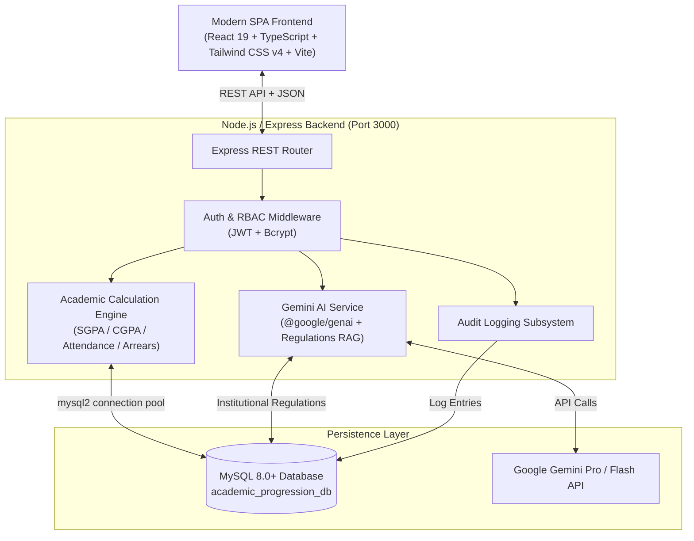

# 🎓 Academic Progress & Achievement Tracking System

[](https://react.dev/)
[](https://www.typescriptlang.org/)
[](https://nodejs.org/)
[](https://expressjs.com/)
[](https://www.mysql.com/)
[](https://tailwindcss.com/)
[](https://ai.google.dev/)
[](https://vitejs.dev/)

An enterprise-grade, full-stack Academic ERP & Student Performance Analytics platform designed for universities and higher education institutions. Features multi-role governance (**Student**, **Faculty**, **Controller of Examinations (COE)**, and **Administrator**), automated SGPA/CGPA and arrear calculation engines, session-level biometric attendance tracking, continuous internal assessment (CIA) workflows, tamper-evident audit logging, and **Google Gemini AI** academic intelligence with grounded institutional regulation RAG.

---

## 📑 Table of Contents

- [Key Highlights](#-key-highlights)
- [System Architecture](#-system-architecture)
- [Role-Based Feature Matrix](#-role-based-feature-matrix)
  - [Student Portal](#1-student-portal)
  - [Faculty Portal](#2-faculty-portal)
  - [Controller of Examinations (COE) Portal](#3-controller-of-examinations-coe-portal)
  - [Institutional Administrator Portal](#4-institutional-administrator-portal)
  - [Gemini AI Academic Intelligence & Regulations RAG](#5-gemini-ai-academic-intelligence--regulations-rag)
- [Technology Stack](#-technology-stack)
- [Getting Started](#-getting-started)
  - [Prerequisites](#prerequisites)
  - [Installation](#installation)
  - [Environment Configuration](#environment-configuration)
  - [Database Setup & Automatic Seeding](#database-setup--automatic-seeding)
  - [Running the Application](#running-the-application)
- [Default Demo Credentials](#-default-demo-credentials)
- [REST API Reference](#-rest-api-reference)
- [Database Schema](#-database-schema)
- [Audit & Compliance Framework](#-audit--compliance-framework)
- [Scripts Reference](#-scripts-reference)
- [Production Deployment](#-production-deployment)
- [Troubleshooting & FAQ](#-troubleshooting--faq)
- [License](#-license)

---

## ✨ Key Highlights

- **Dynamic GPA & CGPA Calculation Engine**: Computes semester-wise SGPA and cumulative CGPA across 10-point letter grading scales (`O`, `A+`, `A`, `B+`, `B`, `C`, `U/RA`) compliant with university autonomy regulations.
- **Biometric & Daily Period Attendance**: Supports granular session-wise tracking (Morning/Evening biometric check-ins + periods 1 through 7) with automated 75% attendance shortage condonation warning alerts.
- **Continuous Internal Assessment (CIA) & ESE Management**: Handles IAT 1, IAT 2, model exams, quizzes, assignments, and end-semester examination results with faculty verification.
- **Portfolio & Co-Curricular Tracking**: Centralized repository for national hackathons, global cloud certifications, paper publications, sports accolades, and faculty review workflows.
- **AI Academic Intelligence**: Diagnostic trajectory analytics, strengths detection, actionable intervention roadmaps, and an AI Academic Copilot grounded in institutional regulations via Retrieval-Augmented Generation (RAG).
- **Immutable Audit Trail**: Captures actor IP, role, entity type, previous values, and updated values on every mark revision, attendance change, or certificate verification.

---

## 🏛 System Architecture



---

## 👥 Role-Based Feature Matrix

### 1. Student Portal
- **Consolidated Dashboard**: Instant visibility into current semester SGPA, cumulative CGPA, earned credits, active arrears count, and overall attendance percentage.
- **Attendance Monitor**: Daily period-by-period attendance grid, biometric timestamp verification, course-level breakdown, and warning badges for subjects below 75%.
- **Marks & Examination Center**: Full breakdown of CIA assessments (IAT 1, IAT 2, assignments) and published end-semester examination (ESE) grade sheets.
- **Achievement Portfolio**: Submit student accolades (Hackathons, AWS/Google Cloud certifications, paper presentations) with certificate uploads for faculty verification.
- **Student Profile**: Institutional records including Academic Bank of Credits (ABC ID), UMIS Number, admission type, mentor faculty, and degree status.
- **AI Copilot & Intelligence**: Personal diagnostic review highlighting academic strengths, subject vulnerabilities, and an interactive chat assistant grounded in official university regulations.

### 2. Faculty Portal
- **Class Advisor & Mentor Dashboard**: Real-time cohort analytics, class GPA distribution, quick filters for at-risk students (`attendance < 75%` or `arrears > 0`).
- **Attendance Management**: Batch attendance marker by date and course; support for individual status overrides (`Present`, `Absent`, `On Duty`).
- **Internal Mark Registry**: Input and update CIA/IAT marks with automated validation against maximum mark caps and immediate audit logging.
- **Student Portfolio Verification**: One-click approval/rejection interface for student-submitted achievements with reviewer comments.
- **Comprehensive Student 360° Profile**: Deep drill-down into any assigned student's academic history, historical progression, and performance trajectory.
- **Export & Reports**: Generate student progress transcripts and cohort summary sheets.

### 3. Controller of Examinations (COE) Portal
- **Results Moderation & Publishing**: Semester-wise result compilation, review of provisional grades, and official publishing to student portals.
- **Arrear Registry & Examination Schedules**: Track pending backlogs, supplementary examination registrations, and clearance rates.
- **University Grade Standard Compliance**: Verification of credit weightages, regulation guidelines, and grading distributions across academic departments.

### 4. Institutional Administrator Portal
- **User & Credential Management**: Provision, update, activate, or deactivate accounts across all 4 system roles (`STUDENT`, `FACULTY`, `COE`, `ADMIN`).
- **Academic Setup**: Configure academic years, semesters (Odd/Even), departments, programmes, and course catalogs.
- **Faculty & Course Allocation**: Assign faculty members to courses and enroll students into active semester curricula.
- **System-Wide Audit Logs**: Filterable security and modification log viewer capturing timestamps, actor IDs, roles, IP addresses, and state deltas (`old_value` ➔ `new_value`).

### 5. Gemini AI Academic Intelligence & Regulations RAG
- **Automated Academic Diagnosis**: Generates structured performance assessments, classifying students into risk categories (`Low`, `Medium`, `High`) based on verified records.
- **Strengths & Attention Areas**: Detects subject-level patterns (e.g., strong analytical skills vs. struggle in theory-heavy subjects) with cited evidence.
- **Intervention Roadmap**: Formulates actionable study recommendations, remedial coaching suggestions, and career readiness guidance.
- **Institutional Regulations RAG**: Embeds official clauses (e.g., *Clause 4.2: Condonation limits between 65%-75% on medical grounds*, *Clause 7.1: Letter grading criteria*, *Clause 8.3: Arrear examination policies*) directly into the AI context for zero-hallucination compliance advice.

---

## 🛠 Technology Stack

| Layer | Technology | Details |
| :--- | :--- | :--- |
| **Frontend Framework** | React 19 (`react`, `react-dom`) | Modern component architecture, functional hooks, high performance |
| **Styling & Design** | Tailwind CSS v4, Lucide React, Motion | Premium institutional UI, sleek typography, micro-animations |
| **Data Visualization** | Recharts | Performance curves, SGPA trend lines, attendance gauges |
| **Backend Framework** | Node.js + Express 4.x | RESTful API, structured route handlers, error boundary middleware |
| **Database** | MySQL 8.x (`mysql2/promise`) | Relational schema, pooled connections, foreign keys, transactions |
| **AI & LLM Engine** | Google Gen AI SDK (`@google/genai`) | Gemini Pro/Flash integration with strict JSON schema outputs |
| **Authentication** | Custom Session/JWT + Bcrypt | Multi-role RBAC, password hashing, secure token headers |
| **Build & Bundler** | Vite 6 + esbuild + tsx | Instant HMR development server & optimized production bundles |

---

## 🚀 Getting Started

### Prerequisites

Make sure the following tools are installed on your environment:
- **Node.js**: v18.0.0 or higher ([Download Node.js](https://nodejs.org/))
- **npm**: v9.0.0 or higher (packaged with Node.js)
- **MySQL Server**: v8.0 or higher running locally or accessible via network ([Download MySQL](https://dev.mysql.com/downloads/))

---

### Installation

1. **Clone the repository**:
   ```bash
   git clone https://github.com/Harishh-M/ai-academic-progression-tracking-system.git
   cd ai-academic-progression-tracking-system
   ```

2. **Install project dependencies**:
   ```bash
   npm install
   ```

---

### Environment Configuration

Create a `.env` file in the root directory by copying `.env.example` or creating a new one:

```bash
cp .env.example .env
```

Configure your environment variables as follows:

```env
# Server Port
PORT=3000

# MySQL Database Configuration
DB_HOST=localhost
DB_PORT=3306
DB_USER=root
DB_PASSWORD=your_mysql_password
DB_NAME=academic_progression_db

# Seeding Configuration
# Set to 'true' to auto-seed initial courses, faculty, students, and marks on first boot if DB is empty
AUTO_SEED=true

# Google Gemini API Key (Required for AI Insights, Copilot Chat & Regulations RAG)
# Obtain a free key at: https://aistudio.google.com/app/apikey
GEMINI_API_KEY="your_gemini_api_key_here"

# Application URL
APP_URL="http://localhost:3000"
```

---

### Database Setup & Automatic Seeding

1. Start your local MySQL service.
2. Create the target database:
   ```sql
   CREATE DATABASE IF NOT EXISTS academic_progression_db CHARACTER SET utf8mb4 COLLATE utf8mb4_unicode_ci;
   ```
3. **Automatic Schema Seeding**:
   When you run the server with `AUTO_SEED=true`, the system checks if the database is empty. If so, it automatically provisions all tables, seeds 20 realistic student profiles, faculty members, semesters, courses, attendance sessions, CIA marks, published results, audit logs, and institutional regulations!

---

### Running the Application

#### Development Mode (Frontend HMR + Backend Watcher)
Runs the unified Express + Vite development server with automatic file watching:
```bash
npm run dev
```
Navigate to: **`http://localhost:3000/`** in your browser.

#### Production Build & Run
Compile the React bundle with Vite and package the Node.js server with esbuild:
```bash
# 1. Build client and server bundles
npm run build

# 2. Start the production server
npm start
```

---

## 🔑 Default Demo Credentials

The initial database seed provisions pre-configured institutional accounts across all roles. 

> **Default Universal Password for All Demo Accounts**: `password123`

| Role | Username / Identifier | Alternative ID / Code | Role Description |
| :--- | :--- | :--- | :--- |
| **System Administrator** | `admin` | `usr_admin` | Global user, course, and security administration |
| **Controller of Examinations** | `coe` | `usr_coe` | Result publishing, moderation, and university compliance |
| **Faculty (HOD)** | `FACAD001` | `faculty_rajesh` / `AD001` | Dr. Rajesh Sharma - Prof & HOD (Computer Science) |
| **Faculty (Mentor)** | `FACBM001` | `faculty_priya` / `BM001` | Dr. Priya Natarajan - Associate Professor (AI/ML) |
| **Student (Top Performer)** | `7376232BM001` | `24CSE001` | Arun Kumar (CGPA ~9.3, 0 Arrears, 96% Attendance) |
| **Student (At-Risk)** | `7376232BM002` | `24CSE002` | Ravi Shankar (CGPA ~5.4, 3 Arrears, 68% Attendance) |
| **Student (Arrear Case)** | `7376232BM004` | `24CSE004` | Sneha Patel (CGPA ~6.2, 1 Active Arrear) |

*(You can also use the **Quick Role Logins** buttons on the login page to sign in with one click).*

---

## 📡 REST API Reference

All API routes are served under `/api` and require a valid Bearer token in the `Authorization` header after login.

### Authentication (`/api/auth`)
- `POST /api/auth/login` — Authenticate using username, student register number, or faculty user ID with password.
- `GET /api/auth/me` — Fetch currently authenticated user session and associated profile.

### Student Management (`/api/students`)
- `GET /api/students` — List students with filter queries (`search`, `department`, `programme`, `batch`, `status`, `risk`). *(Staff only)*
- `GET /api/students/:id` — Retrieve detailed student biographical and academic profile.
- `GET /api/students/:id/metrics` — Compute live SGPA, CGPA, total credits, arrears, and course-wise attendance.
- `POST /api/students` — Register a new student. *(Admin/Staff)*
- `PUT /api/students/:id` — Update student bio, fees status, or mentor assignment.

### Academic Operations (`/api/academic` & Aliases)
- `GET /api/courses` — Get list of institutional courses and credit mappings.
- `GET /api/semesters` — Retrieve academic semesters and date schedules.
- `GET /api/faculty` — List active faculty members and departmental allocations.
- `GET /api/attendance` — Query attendance logs by `studentId`, `courseId`, or `date`.
- `POST /api/attendance/batch` — Bulk mark attendance for an entire class/session. *(Faculty)*
- `GET /api/marks` — Retrieve CIA marks for a student or course.
- `POST /api/marks` — Create or update internal assessment marks. *(Faculty)*
- `GET /api/results` — Fetch published end-semester examination results.
- `POST /api/results/publish` — Moderate and publish semester results. *(COE/Admin)*
- `GET /api/achievements` — Fetch verified student portfolio achievements.
- `POST /api/achievements` — Submit new student achievement with certificate attachment.
- `PUT /api/achievements/:id/verify` — Approve or reject achievement submission. *(Faculty)*

### AI Intelligence & Regulations (`/api/ai`)
- `POST /api/ai/academic-intelligence/analyze` — Run deep Gemini LLM academic diagnosis on a student record.
- `POST /api/ai/chat` — Conversational assistant with Grounded Institutional Regulation RAG context.
- `GET /api/ai/regulations` — Query institutional regulations handbook by search terms.

### Reports & Compliance (`/api/reports` & `/api/audit-logs`)
- `GET /api/reports/student/:studentId` — Generate official student academic transcript JSON.
- `GET /api/reports/faculty` — Generate cohort performance and risk analysis summary.
- `GET /api/audit-logs` — Retrieve immutable audit trail with actor details and state diffs. *(Admin/Faculty)*

---

## 🗄 Database Schema

The system uses a relational MySQL database designed for high referential integrity and institutional compliance:

```
├── users                       (Authentication credentials, roles: STUDENT/FACULTY/COE/ADMIN, status)
├── faculty                     (Faculty bio, designation, department, qualification, joining date)
├── students                    (Register number, admission number, ABC ID, UMIS ID, status, mentor)
├── semesters                   (Semester number, academic year, Odd/Even type, start/end dates)
├── courses                     (Course code, title, credits, department, core/elective type)
├── faculty_courses             (Faculty-to-course semester assignment mappings)
├── student_courses             (Student-to-course enrollment records)
├── attendance                  (Date, session, student ID, course ID, status: Present/Absent)
├── internal_marks              (CIA assessments: IAT1, IAT2, Model, Assignments, maximum marks)
├── semester_results            (End-semester letter grades, grade points, credits, pass/fail status)
├── achievements                (Co-curricular awards, certifications, verification status, file proofs)
├── audit_logs                  (Immutable action log: user ID, role, action, old/new values, IP, timestamp)
└── institutional_regulations   (Official university academic clauses for LLM RAG retrieval)
```

---

## 🛡 Audit & Compliance Framework

In accordance with higher education accreditation bodies (such as NAAC, NBA, and ABET), institutional data modifications must be accountable:
1. **Zero Silent Edits**: Whenever a faculty member updates an internal mark or alters an attendance record, the backend logs the change in `audit_logs` before committing the transaction.
2. **State Diffs**: Old and new values are serialized in JSON format for side-by-side verification.
3. **IP & Actor Tracking**: Records the exact user, institutional role, client IP address, and server timestamp.

---

## 📜 Scripts Reference

In the project root, you can execute:

| Command | Description |
| :--- | :--- |
| `npm run dev` | Starts the unified development server (`tsx watch server.ts` + Vite middleware) |
| `npm run build` | Compiles the React production bundle to `dist/` and builds `dist/server.cjs` via esbuild |
| `npm start` | Launches the production Node.js server (`node dist/server.cjs`) |
| `npm run preview` | Previews the Vite production build locally |
| `npm run lint` | Runs TypeScript type checking across the entire project (`tsc --noEmit`) |
| `npm run db:clean` | Truncates all tables while preserving structures, foreign keys, and indexes |

---

## 🌐 Production Deployment

### Option 1: Standalone Linux / Cloud VM (Ubuntu/Debian)

1. **Install Node.js & MySQL**:
   ```bash
   sudo apt update && sudo apt install -y nodejs npm mysql-server
   ```
2. **Clone & Configure**:
   ```bash
   git clone https://github.com/Harishh-M/ai-academic-progression-tracking-system.git /var/www/academic-erp
   cd /var/www/academic-erp
   npm install
   cp .env.example .env
   # Configure production DB credentials and GEMINI_API_KEY in .env
   ```
3. **Build the Project**:
   ```bash
   npm run build
   ```
4. **Run with PM2 Process Manager**:
   ```bash
   npm install -g pm2
   NODE_ENV=production pm2 start dist/server.cjs --name "academic-erp"
   pm2 startup
   pm2 save
   ```
5. **Setup Nginx Reverse Proxy**:
   Proxy port `80`/`443` traffic to `http://127.0.0.1:3000`.

### Option 2: Docker / Container Deployment

Create a `Dockerfile` in the root:
```dockerfile
FROM node:20-alpine
WORKDIR /app
COPY package*.json ./
RUN npm install
COPY . .
RUN npm run build
EXPOSE 3000
ENV NODE_ENV=production
CMD ["node", "dist/server.cjs"]
```

---

## ❓ Troubleshooting & FAQ

<details>
<summary><b>1. Database connection error (ECONNREFUSED) on startup?</b></summary>
Ensure MySQL server is actively running on the configured port (default `3306`).
- On macOS: `brew services start mysql`
- On Linux: `sudo systemctl start mysql`
- On Windows: Start MySQL from the Services management panel.
Verify credentials in your `.env` file match your MySQL user and password.
</details>

<details>
<summary><b>2. How can I reset the database to clean initial state?</b></summary>
Run:
```bash
npm run db:clean
```
Then restart the server with `AUTO_SEED=true` in `.env` to re-seed all sample data cleanly.
</details>

<details>
<summary><b>3. Why is Gemini AI analysis returning fallback responses?</b></summary>
Gemini AI requires a valid Google Gemini API key. Ensure `GEMINI_API_KEY` is defined in your `.env` file. You can generate a free API key at [Google AI Studio](https://aistudio.google.com/). If no key is provided, the system gracefully falls back to deterministic rule-based academic recommendations.
</details>

<details>
<summary><b>4. How do I change an account password?</b></summary>
Administrators can update user passwords directly from the Admin Portal (`/admin`). Passwords are automatically hashed with Bcrypt before persistence in MySQL.
</details>

---

## 📄 License

This project is licensed under the **MIT License**. You are free to use, modify, and distribute this software for educational and institutional purposes.

---

<div align="center">
  <sub>Built with ❤️ for modern higher education institutions and university excellence.</sub>
</div>
